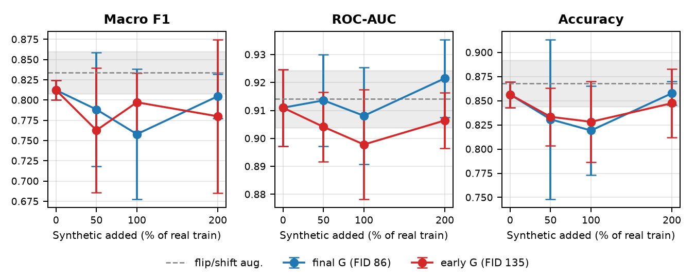
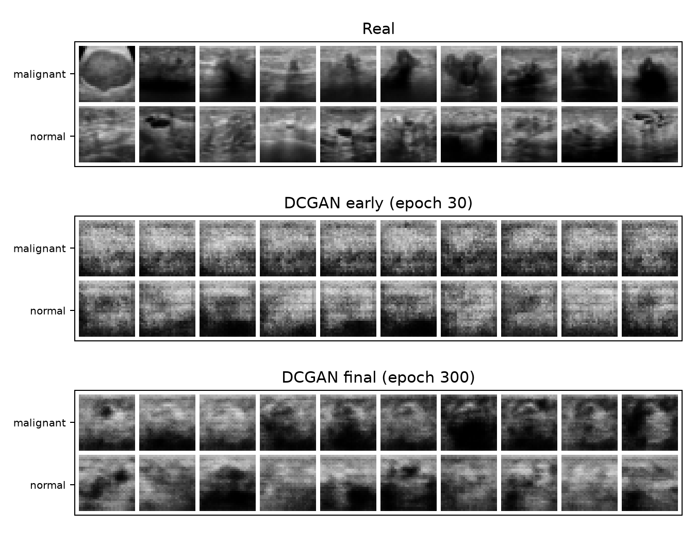
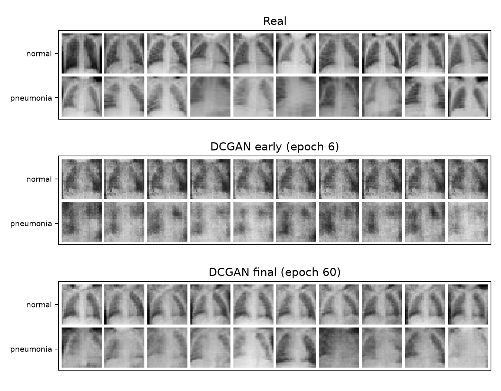

# Does Synthetic Data Help? GAN Augmentation for Small Medical Datasets

**Team 33 · Project P33 · Deep Learning, Sitare University**

Medical imaging datasets are small and imbalanced. We train a **class-conditional DCGAN** on the real
training images of [MedMNIST v2](https://medmnist.com/), add 0 / 50 / 100 / 200 % synthetic images to the
training set, and measure whether a CNN classifier gets better on a **held-out, purely real test set**.
We also vary the *quality* of the synthetic data (an early vs. a fully trained generator, scored with FID/KID)
to separate the effect of **how much** synthetic data is added from **how good** it is.

## Key results

| | BreastMNIST (546 train images) | PneumoniaMNIST (4,708 train images) |
|---|---|---|
| Real-only macro F1 / AUC | **0.812** / 0.911 | **0.861** / 0.973 |
| Best GAN setting, macro F1 | 0.819 (class balancing, p = 0.74) | 0.855 (+200 %, p = 0.65) |
| Best AUC | **0.922** (+200 % GAN) | **0.976** (+200 % GAN) |
| Flip/shift augmentation, F1 | **0.834** (best) | 0.755 (worst — mirrored chests are anatomically wrong) |
| FID final / early generator (real-vs-real floor) | 86.4 / 134.9 (59.1) | 108.1 / 193.3 (25.3) |
| Generated images closer to a training image than 95 % of unseen real images (≈5 % expected) | 0 % | 1.9 % |

- **GAN images did not raise macro F1** on either dataset at any amount (50–200 %); no difference is significant over 5 (3) seeds.
- **Quality matters**: the final generator beats the early one in AUC at every ratio.
- **+200 % synthetic gives the best AUC** on both datasets, and on PneumoniaMNIST cuts seed-to-seed F1 variance from 0.021 to 0.004.
- **No memorisation**: the generator does not copy training images (nearest-neighbour check), though sample diversity is limited.

Full tables: [`results/breastmnist/results_table.md`](results/breastmnist/results_table.md),
[`results/pneumoniamnist/results_table.md`](results/pneumoniamnist/results_table.md) · report source: [`report/`](report/).

<p align="center">
  <br>
  <em>BreastMNIST: metrics vs amount of synthetic data — final (blue) vs early (red) generator, grey band = flip/shift.</em>
</p>
<p align="center">
  
  <br>
  <em>Real images vs early and final DCGAN samples (left: breast ultrasound, right: chest X-ray).</em>
</p>

## Dataset choice

The Issue #1 exploration (`notebooks/01_dataset_exploration.ipynb`) compared both MedMNIST candidates and picked
**PneumoniaMNIST** for GAN training because it has 4,708 training images (BreastMNIST: 546). We kept it, and also ran
the full study on **BreastMNIST**, because a tiny, imbalanced dataset (27 % malignant) is exactly where synthetic data is
supposed to help most. The report treats BreastMNIST as the main stress test and PneumoniaMNIST as the larger-data check.
Both use the official MedMNIST train / val / test splits at 28×28.
Detailed dataset notes (statistics, leakage safeguards, loader usage) from Issue #1: [`docs/DATASET.md`](docs/DATASET.md).

## Interactive demo

```bash
python app.py        # http://127.0.0.1:7860
```

| Tab | What you can do |
|---|---|
| 🧬 Generate | Draw synthetic scans of a chosen class from the early or final generator; play a latent-space walk |
| 🎯 Spot the Fake | A real scan vs a GAN scan — guess which is real, with a running score |
| 🔬 Classify | Same real test image through Model A (real only) and Model B (real + 100 % GAN) side by side |
| 📊 Results | Headline cards, the full results table and all figures |
| 🧭 How it works | The six pipeline steps at a glance |

## Pipeline

```
MedMNIST v2 (official train / val / test splits)
      │
      ├── train ──► conditional DCGAN ──► G_early (≈10% of training) , G_final
      │                                        │
      │                                        ├──► FID / KID vs. real train images
      │                                        ▼
      ├── train ──► + synthetic images (0/50/100/200 %, same class ratio, nested subsets)
      │                │                        + GAN class balancing, + flip/shift baseline
      │                ▼
      │           CNN classifier × 5 seeds (best checkpoint by validation AUC)
      │
      └── test (real only, never seen by the GAN) ──► accuracy, precision, recall, F1, AUC, confusion matrix
```

**No leakage:** the GAN is trained on the training split only; validation and test sets contain only real
images and are identical in every experiment (enforced in `ganaug/augment.py`, checked in `tests/`).

## Repository layout

| Path | What it does | Issue |
|---|---|---|
| `src/data/dataset.py`, `notebooks/01_dataset_exploration.ipynb`, `tests/test_dataset.py`, `docs/DATASET.md` | MedMNIST loaders, split-overlap (leakage) checks, dataset exploration | #1 |
| `ganaug/config.py`, `ganaug/data.py` | Shared paths/seeds; tensors in [-1, 1] built on the #1 loaders, random-shift helper | #2 |
| `ganaug/cnn.py`, `ganaug/classifier.py` | CNN classifier, training with best-val-AUC selection, metrics | #2 |
| `ganaug/dcgan.py` | Conditional DCGAN generator and discriminator | #3 |
| `ganaug/train_gan.py` | GAN training loop (DiffAugment-style translation, label smoothing), checkpoints, samples | #4 |
| `ganaug/augment.py`, `ganaug/explore.py` | Mixes real and synthetic images at controlled ratios; dataset overview figure | #5 |
| `ganaug/fid.py` | FID / KID of generated images (torch-fidelity) | #6 |
| `ganaug/experiments.py`, `ganaug/report.py` | All settings × seeds, comparison tables and figures | #7 |
| `run_all.sh`, `tests/test_pipeline.py`, `app.py`, `.github/` | End-to-end run, pipeline tests, demo web app, CI | #8 |
| `report/` | LaTeX source (ELCVIA template), figures and the final PDF | #9 |
| `results/` | Every number and figure used in the report | |

## Setup

Python 3.10+; runs on CPU, no GPU needed (BreastMNIST end to end: about 1–2 hours on a laptop; PneumoniaMNIST: about 3 hours).

```bash
python -m venv .venv
source .venv/bin/activate          # Windows: .venv\Scripts\activate
pip install -r requirements.txt
python verify_installation.py      # checks the installed packages
pytest -q                          # 43 tests: dataset/leakage checks (#1) + pipeline tests
```

## Reproduce

```bash
bash run_all.sh                    # both datasets, end to end
```

or step by step:

```bash
python -m ganaug.explore                                        # dataset stats  -> results/dataset_*.{json,png}
python -m ganaug.train_gan  --dataset breastmnist --epochs 300 --early-epoch 30
python -m ganaug.fid        --dataset breastmnist               # -> results/breastmnist/fid.json
python -m ganaug.experiments --dataset breastmnist --seeds 0 1 2 3 4
python -m ganaug.report     --dataset breastmnist               # figures + results_table.{md,tex}
```

Data is downloaded automatically into `data/`; generator checkpoints go to `checkpoints/` (both git-ignored).

### GAN training runs and checkpoints

The GAN was trained twice with the same code, configuration and seed, on two different laptops:

| | Run 1 (Arjun) | Run 2 (Bhagwati) |
|---|---|---|
| Used for | Every number and figure in the report (FID, F1/AUC tables, all plots) | Reproducibility check (report §6.1) |
| Loss log | `results/<dataset>/report_run/gan_losses.csv` | `results/<dataset>/gan_losses.csv`, `gan_samples/` |
| Checkpoints | [checkpoints (report run)](https://drive.google.com/file/d/1JHWhWtQJ8be1L8MP2bBrhAI6I45mLU8O/view?usp=sharing) | shared in the team Drive |
| Final D loss (avg. last 10 % of epochs) | Breast 1.371 · Pneumonia 1.376 | Breast 1.377 · Pneumonia 1.377 |

Both runs reach the same balanced state (D(x) ≈ D(G(z)) ≈ 0.45). They are not bit-identical, because CPU
floating-point results differ slightly across machines and library versions. To reproduce the report's numbers without
retraining, unzip the report-run checkpoints into the repo root (`checkpoints/breastmnist/G_early.pt`, `G_final.pt`,
`checkpoints/pneumoniamnist/...`), then run `ganaug.fid`, `ganaug.experiments` and `ganaug.report`.

## Team

| Member | Work |
|---|---|
| Arjun Kadam | Augmentation pipeline (#5), integration, testing, CI and demo app (#8), report (#9) |
| Bhagwati | DCGAN architecture (#3) and GAN training (#4); repository owner, team workflow, PR review and merges |
| Maneesh Sakhwar | Dataset preparation, exploration notebook and leakage tests (#1), FID evaluation (#6) |
| Anand Singh | CNN baseline (#2), result comparison (#7) |

## References

1. A. Radford, L. Metz, S. Chintala. *Unsupervised Representation Learning with Deep Convolutional GANs.* ICLR 2016. [arXiv:1511.06434](https://arxiv.org/abs/1511.06434)
2. M. Frid-Adar et al. *GAN-based Synthetic Medical Image Augmentation for Increased CNN Performance in Liver Lesion Classification.* Neurocomputing 2018. [arXiv:1803.01229](https://arxiv.org/abs/1803.01229)
3. J. Yang et al. *MedMNIST v2: A Large-Scale Lightweight Benchmark for 2D and 3D Biomedical Image Classification.* Scientific Data 2023. [arXiv:2110.14795](https://arxiv.org/abs/2110.14795)
4. M. Mirza, S. Osindero. *Conditional Generative Adversarial Nets.* 2014. [arXiv:1411.1784](https://arxiv.org/abs/1411.1784)
5. S. Zhao et al. *Differentiable Augmentation for Data-Efficient GAN Training.* NeurIPS 2020. [arXiv:2006.10738](https://arxiv.org/abs/2006.10738)
6. M. Heusel et al. *GANs Trained by a Two Time-Scale Update Rule Converge to a Local Nash Equilibrium (FID).* NeurIPS 2017. [arXiv:1706.08500](https://arxiv.org/abs/1706.08500)
